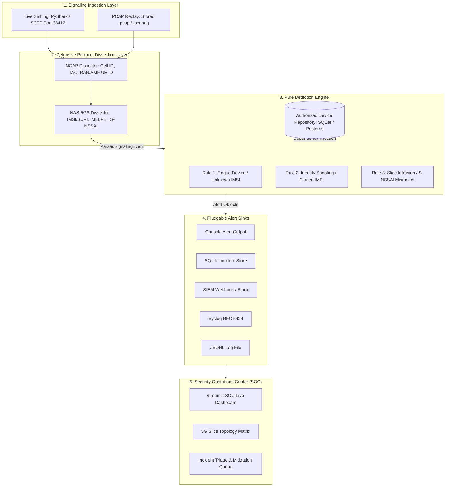

# 🛡️ NASWatch: Rogue eSIM & 5G Network-Slice Intrusion Detector

[](https://github.com/megbaru/naswatch/actions)
[](https://www.python.org/)
[](https://opensource.org/licenses/MIT)
[](https://github.com/astral-sh/ruff)

> **A passive 5G control-plane Intrusion Detection System (IDS) that inspects NGAP/NAS signaling traffic to detect unauthorized devices, identity spoofing (SIM cloning / swapping), unauthorized network-slice access, cipher downgrades, false base stations, and signaling floods — raising real-time alerts through a live SOC dashboard, SOAR engine, and enterprise REST API.**

---

## 📌 Problem Statement & Motivation

5G Standalone (SA) networks introduce **Network Slicing** (3GPP TS 23.501), allowing telecommunication providers and private enterprises to partition a single physical infrastructure into logically isolated virtual networks (e.g., eMBB for public data, URLLC for critical industrial robotics/first-responders, and isolated Enterprise Private slices).

However, cellular signaling is exposed to novel attack vectors:
1. **Rogue eSIMs / Unauthorized Devices:** Unprovisioned devices transmitting on licensed carrier frequencies or attempting malicious registration.
2. **Identity Spoofing & SIM Cloning:** An attacker extracts an authorized subscriber's IMSI/SUPI credentials but transmits from an unauthorized hardware IMEI/PEI.
3. **Network-Slice Hopping / Intrusion:** A standard IoT or mobile subscriber attempting unauthorized connection requests (`PDU Session Establishment`) to high-priority emergency (URLLC) or enterprise slices (`S-NSSAI`).
4. **Cipher / Integrity Downgrade:** A rogue radio node negotiating null ciphers (NEA0/NIA0) to strip 5G AS/NAS security and enable man-in-the-middle traffic capture.
5. **False Base Station / Rogue gNB:** A device registering from a Cell ID not present in the authorized radio cell inventory.
6. **Signaling Flood / Registration Storm:** A single IMSI generating anomalous volumes of NAS registration requests in a short time window (DoS / credential-stuffing precursor).

**NASWatch** operates at the **gNB ↔ AMF N2/N1 signaling interface**, passively sniffing SCTP signaling traffic, dissecting NGAP (TS 38.413) and 5GS NAS (TS 24.501) protocols, evaluating pure detection rules, and alerting security operators via SIEM webhooks, syslog, and a live SOC dashboard.

---

## 🏗️ System Architecture



---

## 🎯 Detection Rules (6 Rules)

| Rule ID | Rule Name | Trigger Condition | 3GPP Layer | Severity |
|---|---|---|---|---|
| `RULE-5G-01` | **Rogue Device / Unauthorized eSIM** | Captured IMSI/SUPI is not present in the authorized inventory, or subscriber status is `REVOKED`/`SUSPENDED`. | TS 24.501 `RegistrationRequest` / TS 38.413 `InitialUEMessage` | **CRITICAL** |
| `RULE-5G-02` | **Identity Spoofing / SIM Cloning** | IMSI matches authorized inventory, but observed hardware IMEI/PEI does not match provisioned device. | TS 24.501 `SecurityModeComplete` / `IdentityResponse` | **HIGH** |
| `RULE-5G-03` | **Network-Slice Intrusion** | Device attempts connection to an S-NSSAI (SST/SD) slice not provisioned in its entitlement profile. | TS 24.501 `PDUSessionEstablishmentRequest` | **MEDIUM** |
| `RULE-5G-04` | **Cipher/Integrity Downgrade** | Negotiated NAS cipher is `NEA0` (null encryption) or NAS integrity is `NIA0` (null integrity), indicating a possible man-in-the-middle attack. | TS 24.501 `SecurityModeCommand` | **HIGH** |
| `RULE-5G-05` | **False Base Station / Rogue gNB** | Signaling originates from a Cell ID not present in the authorized radio cell inventory. | TS 38.413 NGAP `InitialUEMessage` Cell ID | **CRITICAL** |
| `RULE-5G-06` | **Signaling Flood / Registration Storm** | A single IMSI generates more than N `RegistrationRequest` messages within a configurable sliding time window (default: 10 requests / 60 s). | TS 24.501 `RegistrationRequest` | **HIGH** |

---

## 📂 Repository Structure

```
naswatch/
├── pyproject.toml              # Package metadata and dependencies
├── requirements.txt            # Pinned dependencies
├── .env.example                # Secrets and configuration template
├── README.md                   # Project documentation & architecture blueprint
├── LICENSE                     # MIT License
├── Dockerfile                  # Multi-stage production container build
├── docker-compose.yml          # Orchestrates API, UI, and Prometheus containers
├── naswatch.service            # systemd unit for edge daemon deployment
│
├── config/
│   ├── settings.yaml           # Non-secret config: thresholds, capture mode, slice policy
│   ├── prometheus.yml          # Prometheus scrape config (targets port 8000 /metrics)
│   └── open5gs/                # Virtual 5G core reference configurations (AMF, gNB, SMF)
│       ├── amf.yaml
│       ├── gnb.yaml
│       └── smf.yaml
│
├── src/
│   └── naswatch/               # Core installable Python package
│       ├── __init__.py
│       ├── logging_config.py   # Structured JSON logging
│       ├── storage/            # Domain models & swappable repository pattern
│       │   ├── models.py       # Device, Alert, SliceAssignment, ParsedSignalingEvent
│       │   ├── repository.py   # Abstract DeviceRepository & AlertRepository
│       │   └── sqlite_repo.py  # SQLite implementation (supports in-memory for tests)
│       ├── parsing/            # Layered 3GPP protocol dissecting
│       │   ├── ngap_parser.py  # NGAP layer fields & PDU unbundling
│       │   └── nas_parser.py   # NAS-5GS identities & S-NSSAI decoding
│       ├── detection/          # Pure rule evaluation engine
│       │   ├── rules.py        # 6 pure detection rules (zero I/O dependencies)
│       │   └── engine.py       # Stateful orchestrator with dependency injection
│       ├── ingestion/          # Traffic capture sources
│       │   ├── live_capture.py # PyShark live interface sniffing
│       │   └── pcap_replay.py  # Deterministic PCAP replayer
│       ├── alerting/           # Pluggable notification sinks
│       │   └── notifier.py     # Console, SQLite, Webhook, Syslog, JSONL
│       ├── mitigation/         # SOAR: automated response actions
│       │   └── soar.py         # SOAREngine: revoke, quarantine, firewall, forensics
│       └── api/                # Enterprise REST API
│           └── server.py       # FastAPI server with Prometheus metrics exporter
│
├── ui/
│   ├── app.py                  # Streamlit SOC Dashboard entry point (6 tabs)
│   └── components.py           # KPI metrics, donut charts, timeline, slice matrix
│
├── data/                       # Local data directory
│   ├── inventory.db            # SQLite device inventory and incident store
│   └── pcaps/                  # Stored signaling captures (.pcap)
│
├── scripts/
│   ├── sample_devices.csv      # Initial authorized subscriber dataset
│   ├── seed_inventory.py       # Populates inventory DB from CSV
│   └── run_pipeline.py         # Headless CLI runner
│
└── tests/
    ├── conftest.py             # Pytest shared fixtures
    ├── unit/                   # 22 passing unit tests
    │   ├── test_rules.py       # All 6 detection rules
    │   ├── test_parsers.py     # NAS & NGAP parsers
    │   ├── test_repository.py  # SQLite repository
    │   └── test_api_and_soar.py# SOAR engine & FastAPI endpoints
    └── fixtures/
        ├── generate_mock_pcap.py # Synthetic 5G attack traffic generator
        └── sample_packets/     # Static PCAP fixtures
```

---

## ⚡ Quick Start

### 1. Installation

Ensure Python 3.10+ and `tshark` are installed on your Linux system:

```bash
# Ubuntu / Debian system packages
sudo apt-get update
sudo apt-get install -y tshark libpcap-dev wireshark-common

# Clone repository
git clone https://github.com/megbaru/naswatch.git
cd naswatch

# Install dependencies and package in editable mode
python3 -m pip install -e ".[dev]"
```

### 2. Seed Authorized Device Inventory

Populate the database with sample provisioned subscribers and slice allocations:

```bash
python3 scripts/seed_inventory.py --csv scripts/sample_devices.csv --db data/inventory.db
```

### 3. Generate Synthetic 5G Attack PCAP

Generate a synthetic 5G control-plane PCAP containing legitimate traffic and all 6 attack vectors:

```bash
python3 tests/fixtures/generate_mock_pcap.py
```

### 4. Run Headless Pipeline (CLI)

Run the detection engine directly from the command line:

```bash
# Replay synthetic PCAP
python3 scripts/run_pipeline.py --mode replay --pcap data/pcaps/5g_signaling_demo.pcap

# Or run live interface sniffing
python3 scripts/run_pipeline.py --mode live --interface eth0
```

### 5. Launch the Streamlit SOC Dashboard

Start the live web dashboard:

```bash
streamlit run ui/app.py
```

Open your browser at `http://localhost:8501`. The dashboard has **6 tabs**:

| Tab | Description |
|---|---|
| 📊 Overview | KPI cards, live alert feed, severity distribution donut chart |
| 🗺️ Topology | 5G Slice topology matrix with alert heat-map |
| 🚨 Incidents | Filterable incident table with inline SOAR action buttons |
| 📡 Devices | Authorized device inventory viewer |
| 📈 Timeline | Alert timeline chart |
| ⚡ Enterprise API & SOAR | Live API status, SOAR actions, downloadable forensic reports |

### 6. Start the Enterprise REST API

```bash
uvicorn naswatch.api.server:app --host 0.0.0.0 --port 8000
```

Swagger UI available at `http://localhost:8000/docs`. Prometheus metrics at `http://localhost:8000/metrics`.

---

## 🧪 Testing & Quality Assurance

Run the comprehensive unit test suite (22 tests):

```bash
pytest -v tests/unit/
```

Expected output:
```
tests/unit/test_api_and_soar.py::test_soar_engine_revocation_and_report PASSED
tests/unit/test_api_and_soar.py::test_fastapi_rest_endpoints PASSED
tests/unit/test_rules.py::test_rogue_device_detection PASSED
tests/unit/test_rules.py::test_identity_spoofing_detection PASSED
tests/unit/test_rules.py::test_slice_intrusion_detection PASSED
tests/unit/test_rules.py::test_cipher_downgrade_detection PASSED
tests/unit/test_rules.py::test_false_base_station_detection PASSED
tests/unit/test_rules.py::test_signaling_flood_detection PASSED
... (22 passed, 0 warnings)
```

Check code formatting and linting:

```bash
ruff check src/ tests/ scripts/
```

---

## 🤖 SOAR Engine (Automated Response)

The **Security Orchestration, Automation, and Response (SOAR)** engine ([`src/naswatch/mitigation/soar.py`](src/naswatch/mitigation/soar.py)) provides automated mitigation actions triggered directly from the SOC dashboard or REST API.

| Action | Method | Effect |
|---|---|---|
| **Revoke at 5GC** | `SOAREngine.revoke_subscriber(imsi)` | Marks subscriber as `REVOKED` in the inventory DB and logs the action |
| **Quarantine IMSI** | `SOAREngine.quarantine_device(imsi)` | Marks subscriber as `SUSPENDED`, preventing further authentication |
| **Generate Firewall Rule** | `SOAREngine.generate_firewall_drop_rule(imsi, cell_id)` | Returns an `iptables`-compatible drop rule for the offending Cell ID |
| **Forensic Report** | `SOAREngine.generate_forensic_report(alert)` | Exports a JSON forensic evidence bundle (timestamps, rule type, evidence fields, recommended actions) |

SOAR action buttons appear inline on each alert card in the Streamlit UI under the **Incidents** tab.

---

## 🌐 Enterprise REST API

The FastAPI server ([`src/naswatch/api/server.py`](src/naswatch/api/server.py)) exposes a fully documented REST API and Prometheus metrics endpoint.

### API Endpoints

| Method | Endpoint | Description |
|---|---|---|
| `GET` | `/` | Service info & version |
| `GET` | `/health` | Health check (uptime, alert count, device count) |
| `GET` | `/metrics` | **Prometheus** text-format metrics |
| `GET` | `/api/v1/alerts` | List all alerts (supports `?limit=` & `?severity=` filters) |
| `GET` | `/api/v1/alerts/{id}` | Get single alert by ID |
| `POST` | `/api/v1/alerts/{id}/mitigate` | Trigger SOAR revocation for an alert's IMSI |
| `GET` | `/api/v1/devices` | List all authorized devices |
| `POST` | `/api/v1/devices` | Provision a new authorized device |
| `DELETE` | `/api/v1/devices/{imsi}` | Revoke / remove a device from inventory |
| `POST` | `/api/v1/ingest/event` | Inject a synthetic signaling event for analysis |

### Prometheus Metrics

The `/metrics` endpoint exports the following counters and gauges:

| Metric | Type | Description |
|---|---|---|
| `naswatch_packets_inspected_total` | Counter | Total signaling packets processed |
| `naswatch_alerts_generated_total` | Counter | Total alerts by `rule_type` and `severity` labels |
| `naswatch_provisioned_devices_total` | Gauge | Current authorized device inventory size |

---

## 🐳 Docker Deployment

Deploy the full NASWatch stack (API + SOC Dashboard + Prometheus) with a single command:

```bash
docker-compose up --build
```

This starts three containers:

| Service | Port | Description |
|---|---|---|
| `naswatch-api` | `8000` | FastAPI REST API + Prometheus metrics exporter |
| `naswatch-ui` | `8501` | Streamlit SOC Dashboard |
| `prometheus` | `9090` | Prometheus time-series database scraping the API |

To run in detached mode:

```bash
docker-compose up -d --build
```

To tear down:

```bash
docker-compose down -v
```

---

## ⚙️ systemd Edge Daemon Deployment

Deploy NASWatch as a persistent background daemon on an edge node:

```bash
# Copy service unit
sudo cp naswatch.service /etc/systemd/system/

# Reload systemd and enable at boot
sudo systemctl daemon-reload
sudo systemctl enable naswatch
sudo systemctl start naswatch

# Check status and follow logs
sudo systemctl status naswatch
sudo journalctl -u naswatch -f
```

The `naswatch.service` unit automatically restarts on failure (`Restart=on-failure`) and logs to the systemd journal.

---

## 🔬 Virtual 5G Core Testbed Setup (Open5GS & UERANSIM)

NASWatch was designed and validated against an Open5GS (5G Core) and UERANSIM (gNB & UE simulator) lab environment.

### 1. Install Open5GS
```bash
sudo add-apt-repository ppa:open5gs/latest
sudo apt-get update
sudo apt-get install -y open5gs
```

### 2. Deploy Configuration
Copy the provided Open5GS configs from `config/open5gs/`:
```bash
sudo cp config/open5gs/amf.yaml /etc/open5gs/amf.yaml
sudo cp config/open5gs/smf.yaml /etc/open5gs/smf.yaml
sudo systemctl restart open5gs-amfd open5gs-smfd
```

### 3. Run UERANSIM gNB
```bash
./nr-gnb -c config/open5gs/gnb.yaml
```

### 4. Attach NASWatch to N2 Interface
```bash
python3 scripts/run_pipeline.py --mode live --interface any
```

---

## ⚠️ Research Disclaimer

> **IMPORTANT:** NASWatch is a specialized research and laboratory defensive tool tested against virtual 5G core testbeds (Open5GS, UERANSIM, free5GC). It is intended for authorized security audits, private 5G network monitoring, and academic research. It is **not** intended for interception of live public carrier networks.

---

## 📄 License

This project is licensed under the [MIT License](LICENSE).
