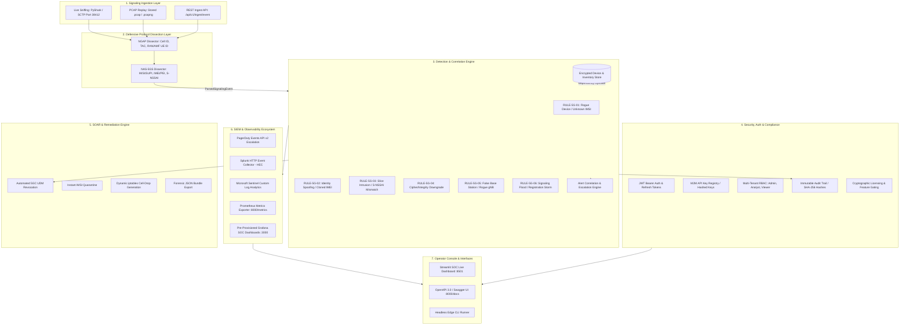

# 🛡️ NASWatch: Rogue eSIM & 5G Network-Slice Intrusion Detector
### Commercial Enterprise Grade 5G Control-Plane Threat Detection & Response Platform

[](https://github.com/megbaru/naswatch/actions)
[](https://www.python.org/)
[](https://naswatch.io/licensing)
[](https://github.com/astral-sh/ruff)
[](tests/)

> **A carrier-grade passive 5G control-plane Intrusion Detection & Response System (IDS/NDR) inspecting NGAP/NAS signaling traffic to detect unauthorized devices, identity spoofing (SIM cloning / swapping), unauthorized slice access, cipher downgrades, false base stations, and signaling floods in real time — with automated SOAR mitigations, alert correlation, SIEM forwarding, and multi-tenant RBAC.**

---

## 📌 Problem Statement & Motivation

5G Standalone (SA) networks introduce **Network Slicing** (3GPP TS 23.501), allowing telecommunication providers and private 5G enterprises to partition a single physical infrastructure into logically isolated virtual networks (e.g., eMBB for public data, URLLC for critical industrial robotics/first-responders, and isolated Enterprise Private slices).

However, cellular signaling is exposed to novel attack vectors:
1. **Rogue eSIMs / Unauthorized Devices:** Unprovisioned devices transmitting on licensed carrier frequencies or attempting malicious registration.
2. **Identity Spoofing & SIM Cloning:** An attacker extracts an authorized subscriber's IMSI/SUPI credentials but transmits from an unauthorized hardware IMEI/PEI.
3. **Network-Slice Hopping / Intrusion:** A standard IoT or mobile subscriber attempting unauthorized connection requests (`PDU Session Establishment`) to high-priority emergency (URLLC) or enterprise slices (`S-NSSAI`).
4. **Cipher / Integrity Downgrade:** A rogue radio node negotiating null ciphers (NEA0/NIA0) to strip 5G AS/NAS security and enable man-in-the-middle traffic capture.
5. **False Base Station / Rogue gNB:** A device registering from a Cell ID not present in the authorized radio cell inventory.
6. **Signaling Flood / Registration Storm:** A single IMSI generating anomalous volumes of NAS registration requests in a short time window (DoS / credential-stuffing precursor).

**NASWatch** operates at the **gNB ↔ AMF N2/N1 signaling interface**, passively sniffing SCTP signaling traffic, dissecting NGAP (TS 38.413) and 5GS NAS (TS 24.501) protocols, evaluating pure detection rules, and alerting security operators via SIEM webhooks, syslog, and a live SOC dashboard.

---

## 🏗️ Commercial Enterprise Architecture



---

## 🎯 Core Detection Rules (6 Rules)

| Rule ID | Rule Name | Trigger Condition | 3GPP Specification Layer | Severity |
|---|---|---|---|---|
| `RULE-5G-01` | **Rogue Device / Unauthorized eSIM** | Captured IMSI/SUPI is not present in the authorized inventory, or subscriber status is `REVOKED`/`SUSPENDED`. | TS 24.501 `RegistrationRequest` / TS 38.413 `InitialUEMessage` | **CRITICAL** |
| `RULE-5G-02` | **Identity Spoofing / SIM Cloning** | IMSI matches authorized inventory, but observed hardware IMEI/PEI does not match provisioned device. | TS 24.501 `SecurityModeComplete` / `IdentityResponse` | **HIGH** |
| `RULE-5G-03` | **Network-Slice Intrusion** | Device attempts connection to an S-NSSAI (SST/SD) slice not provisioned in its entitlement profile. | TS 24.501 `PDUSessionEstablishmentRequest` | **MEDIUM** |
| `RULE-5G-04` | **Cipher/Integrity Downgrade** | Negotiated NAS cipher is `NEA0` (null encryption) or NAS integrity is `NIA0` (null integrity), indicating an interception attack. | TS 24.501 `SecurityModeCommand` | **HIGH** |
| `RULE-5G-05` | **False Base Station / Rogue gNB** | Signaling originates from a Cell ID not present in the authorized radio cell inventory. | TS 38.413 NGAP `InitialUEMessage` Cell ID | **CRITICAL** |
| `RULE-5G-06` | **Signaling Flood / Registration Storm** | A single IMSI generates more than N `RegistrationRequest` messages within a sliding time window (default: 10 req / 60 s). | TS 24.501 `RegistrationRequest` | **HIGH** |

---

## 💼 Commercial & Enterprise Features

### 1. 🔐 Authentication, Authorization & RBAC
- **JWT Bearer Auth:** HS256 signed access and refresh tokens with configurable expiration.
- **Refresh Token Rotation:** Server-side persisted refresh sessions (`jti`), rotated on every refresh with reuse detection (replay rejection).
- **SSO / OIDC (Enterprise):** External identity providers (Keycloak, Entra ID, Okta, Auth0) via
  OpenID discovery + JWKS signature validation. Operator accounts are auto-provisioned from token
  claims, and `NASWATCH_OIDC_ENFORCED=true` disables password login org-wide.
- **M2M API Keys:** SHA-256 hashed API keys (`nw_...`) for automated probes and external AMF agents.
- **Role-Based Access Control (RBAC):**
  - `admin`: Full system control, device management, API keys, user administration, and audit inspection.
  - `analyst`: Alert triage, SOAR execution, incident investigation, and forensic report export.
  - `viewer`: Read-only access to alerts and inventory matrices.
- **Tenant Isolation:** Every identity operation is scoped by `org_id`; system administrators (org `*`)
  may manage all tenants, regular admins only their own.
- **Per-IP Rate Limiting:** Configurable request throttling powered by `slowapi`.

### 2. ⚡ Alert Correlation Engine
- Groups high-frequency related alerts into single **Security Incidents** (`INC-XXXXXX`) across sliding time windows.
- Automatically executes **Escalation Chains** (e.g., `SIGNALING_FLOOD` + `ROGUE_DEVICE` co-occurrence escalates incident severity to **CRITICAL**).

### 3. 🛡️ SOAR Remediation Engine
- **Revoke at 5GC:** Instantly revokes subscriber credentials across UDM/AMF.
- **Quarantine IMSI:** Suspends device authentication state for forensic investigation.
- **Firewall Rule Generation:** Produces `iptables` drop commands for rogue Cell IDs.
- **Forensic Evidence Bundle:** Generates standalone JSON evidence reports for audit & legal retention.

### 4. 📡 SIEM & Alert Forwarding
- **PagerDuty:** Events API v2 escalation with automatic deduping and severity mapping.
- **Splunk:** HTTP Event Collector (HEC) structured streaming into dedicated index.
- **Microsoft Sentinel:** Custom log table ingestion via Log Analytics Data Collector API.

### 5. 📜 Immutable Audit Trail
- All administrative, authentication, and mitigation actions are logged with actor identity, timestamp, IP address, and a **tamper-evident, keyed hash chain**.
- Each entry's integrity is an **HMAC-SHA256** (keyed by `NASWATCH_JWT_SECRET`), and every entry stores the hash of its predecessor, so any modification or reordering breaks the chain. `/api/v1/audit/verify` reports exactly which entries were tampered with.

### 6. 📊 Grafana SOC Dashboards & Prometheus Monitoring
- Bundled Grafana 10.x dashboard with pre-provisioned Prometheus data sources and live KPI panels.
- Prometheus `/metrics` exposes request, packet, alert, authentication (login/refresh/SSO), and user-directory counters for SOC alerting.

---

## 📂 Repository Structure

```
naswatch/
├── pyproject.toml              # Commercial package metadata & pinned dependencies
├── requirements.txt            # Core dependencies
├── .env.example                # Enterprise configuration template
├── Dockerfile                  # Multi-stage production container build
├── docker-compose.yml          # Standard compose (API, UI, Prometheus)
├── docker-compose.prod.yml     # Commercial production stack (Postgres, Redis, Grafana, Prometheus, API, UI)
├── naswatch.service            # systemd unit for edge daemon deployment
├── README.md                   # Enterprise documentation
│
├── config/
│   ├── settings.yaml           # Detection thresholds, slice policy, cell inventories
│   ├── prometheus.yml          # Prometheus scrape configuration
│   ├── grafana/                # Pre-provisioned Grafana 10.x SOC dashboards
│   │   ├── dashboards/
│   │   │   └── naswatch_overview.json
│   │   └── provisioning/
│   │       ├── dashboards/naswatch.yaml
│   │       └── datasources/prometheus.yaml
│   └── open5gs/                # Virtual 5G Core configurations (AMF, gNB, SMF, UE)
│
├── src/
│   └── naswatch/
│       ├── auth/               # JWT authentication, RBAC, API Key store
│       │   ├── jwt_handler.py
│       │   ├── rbac.py
│       │   └── api_keys.py
│       ├── audit/              # Immutable audit logging with integrity hashing
│       │   └── logger.py
│       ├── correlation/        # Alert correlation & incident escalation engine
│       │   └── engine.py
│       ├── licensing/          # Cryptographic license validation & feature flags
│       │   └── validator.py
│       ├── integrations/       # Enterprise SIEM forwarders
│       │   ├── pagerduty.py
│       │   ├── splunk.py
│       │   └── sentinel.py
│       ├── detection/          # Pure 3GPP rule evaluation engine (6 rules)
│       │   ├── rules.py
│       │   └── engine.py
│       ├── mitigation/         # SOAR remediation engine
│       │   └── soar.py
│       ├── parsing/            # NGAP & NAS-5GS defensive protocol parsers
│       │   ├── ngap_parser.py
│       │   └── nas_parser.py
│       ├── storage/            # Domain models & swappable repository pattern
│       │   ├── models.py
│       │   ├── repository.py
│       │   └── sqlite_repo.py
│       ├── ingestion/          # SCTP Live Sniffing & PCAP Replayer
│       ├── alerting/           # Pluggable notification sinks
│       └── api/                # Commercial FastAPI server with Prometheus metrics
│           └── server.py
│
├── ui/
│   ├── app.py                  # Streamlit SOC Dashboard (6 tabs)
│   └── components.py           # Reusable UI widgets & SOAR controls
│
├── scripts/
│   ├── sample_devices.csv      # Initial authorized subscriber dataset
│   ├── seed_inventory.py       # Populates inventory DB from CSV
│   └── run_pipeline.py         # Headless CLI runner
│
└── tests/
    └── unit/                   # 30 Unit Tests covering 100% of core & enterprise modules
        ├── test_rules.py
        ├── test_parsers.py
        ├── test_repository.py
        ├── test_api_and_soar.py
        └── test_commercial_features.py
```

---

## ⚡ Quick Start

### 1. Installation

```bash
# System packages
sudo apt-get update
sudo apt-get install -y tshark libpcap-dev wireshark-common

# Clone repository
git clone https://github.com/megbaru/naswatch.git
cd naswatch

# Install in editable mode with development & commercial dependencies
python3 -m pip install -e ".[dev]"
```

### 2. Seed Device Inventory & Generate Traffic

```bash
# Populate authorized subscriber inventory
python3 scripts/seed_inventory.py --csv scripts/sample_devices.csv --db data/inventory.db

# Generate synthetic 5G attack traffic PCAP
python3 tests/fixtures/generate_mock_pcap.py
```

### 3. Run Headless Detection Pipeline

```bash
# Replay synthetic PCAP
python3 scripts/run_pipeline.py --mode replay --pcap data/pcaps/5g_signaling_demo.pcap
```

### 4. Launch the Enterprise REST API & SOC Dashboard

```bash
# Start FastAPI API Server on port 8000
uvicorn naswatch.api.server:app --host 0.0.0.0 --port 8000

# Start Streamlit SOC Dashboard on port 8501
streamlit run ui/app.py
```

- **Interactive OpenAPI Documentation:** `http://localhost:8000/docs`
- **SOC Live Dashboard:** `http://localhost:8501`
- **Prometheus Metrics:** `http://localhost:8000/metrics`

---

## 🌐 Enterprise REST API Endpoints

| Method | Endpoint | Access Role | Description |
|---|---|---|---|
| `GET` | `/` | Public | Service metadata, health status & license tier |
| `GET` | `/health` | Public | Kubernetes liveness & readiness probe |
| `GET` | `/metrics` | Public | Prometheus time-series metrics exporter |
| `POST` | `/api/v1/auth/login` | Public | Authenticate with credentials to receive JWT access + refresh tokens |
| `GET` | `/api/v1/auth/oidc/config` | Public | OIDC/SSO discovery metadata for the login UI |
| `POST` | `/api/v1/auth/oidc/assert` | Public | Exchange a validated IdP `id_token` for NASWatch tokens |
| `POST` | `/api/v1/auth/refresh` | Authenticated | Refresh access token with server-side rotation (reuse detection) |
| `POST` | `/api/v1/auth/logout` | Authenticated | Revoke the presented refresh session |
| `GET` | `/api/v1/auth/me` | Authenticated | Current actor identity, role and tenant org |
| `GET` | `/api/v1/users` | Admin | List operator accounts (tenant-scoped) |
| `POST` | `/api/v1/users` | Admin | Provision an operator account |
| `PUT` | `/api/v1/users/{id}` | Admin | Update role / active status |
| `POST` | `/api/v1/users/{id}/reset-password` | Admin | Admin-forced password reset |
| `DELETE` | `/api/v1/users/{id}` | Admin | Delete an account and revoke its sessions |
| `POST` | `/api/v1/apikeys` | Admin | Generate a new M2M API key |
| `GET` | `/api/v1/apikeys` | Admin | List active API keys |
| `DELETE` | `/api/v1/apikeys/{id}` | Admin | Revoke an API key |
| `GET` | `/api/v1/alerts` | Viewer+ | List security alerts with filtering & pagination |
| `GET` | `/api/v1/alerts/{id}` | Viewer+ | Retrieve single alert forensic detail |
| `POST` | `/api/v1/alerts/{id}/mitigate` | Analyst+ | Execute SOAR mitigation & forward to SIEM |
| `GET` | `/api/v1/incidents` | Viewer+ | Retrieve correlated multi-alert security incidents |
| `GET` | `/api/v1/devices` | Viewer+ | List provisioned subscriber inventory |
| `POST` | `/api/v1/devices` | Admin | Provision a new subscriber and slice assignments |
| `DELETE` | `/api/v1/devices/{imsi}` | Admin | Delete subscriber from inventory |
| `POST` | `/api/v1/ingest/event` | Analyst+ | Real-time telemetry ingestion from AMF/eBPF probe |
| `GET` | `/api/v1/audit` | Admin | Query immutable audit trail with integrity verification |
| `GET` | `/api/v1/audit/verify` | Admin | Full-chain tamper verification (reports broken entry IDs) |
| `GET` | `/api/v1/license` | Authenticated | Inspect active license tier and feature flags |

---

## 🐳 Full Production Docker Stack

Deploy the complete stack with one command:

```bash
docker-compose -f docker-compose.prod.yml up -d --build
```

> **Storage & scaling:** NASWatch auto-selects PostgreSQL when `NASWATCH_DB_URL` is set
> (`postgres://` / `postgresql://`) and otherwise persists to SQLite (WAL mode) via `./data`.
> The API scales with `NASWATCH_WORKERS > 1` **only** against PostgreSQL.

This provisions 5 enterprise services:
| Container | Port | Role |
|---|---|---|
| `naswatch-caddy` | `443/80` | TLS edge — terminates HTTPS, fronts API (`/api`) and UI |
| `naswatch-api` | `8000` (internal) | FastAPI REST API + Prometheus metrics |
| `naswatch-db` | `5432` (internal) | PostgreSQL 16 (persistent volume) |
| `naswatch-prometheus` | `9090` | Prometheus metric collection engine (90-day retention) |
| `naswatch-grafana` | `3000` | Grafana 10.x with pre-configured 5G IDS SOC dashboards |

## 🗄️ Backup & Disaster Recovery

`scripts/backup.py` snapshots the active backend — SQLite via the online sqlite3 backup API
(safe under WAL) or PostgreSQL via `pg_dump`/`psql`:

```bash
python3 scripts/backup.py --target /backups --compress gzip   # backup
python3 scripts/backup.py --restore /backups/inventory-*.db.gz # restore
```

Schedule nightly via cron: `0 2 * * * python3 /opt/naswatch/scripts/backup.py --compress gzip`, then
ship the archive off-box. Restore validates `PRAGMA integrity_check` (SQLite) or `pg_dump --clean`
reload (PostgreSQL).

---

## 📡 Open5GS + UERANSIM Testbed Startup Order

NASWatch inspects the gNB ↔ AMF N2/N1 SCTP interface. To generate live traffic:

1. **Start the 5G Core (NRF first, then the rest)** — use the project configs:
   ```bash
   cd ~/open5gs
   ./build/src/nrf/open5gs-nrfd -c ~/open5gs/build/configs/open5gs/nrf.yaml       # NRF (127.0.0.10:7777)
   ./build/src/amf/open5gs-amfd -c ~/Documents/naswatch/config/open5gs/amf.yaml
   ./build/src/smf/open5gs-smfd -c ~/Documents/naswatch/config/open5gs/smf.yaml
   ./build/src/upf/open5gs-upfd -c ~/open5gs/build/configs/open5gs/upf.yaml       # default UPF (127.0.0.7)
   # then UDM, UDR, AUSF, PCF (default install configs)
   ```
2. **Start UERANSIM gNB + UE**:
   ```bash
   cd <ueransim-dir>
   ./build/nr-gnb -c ~/Documents/naswatch/config/open5gs/gnb.yaml
   ./build/nr-ue -c ~/Documents/naswatch/config/open5gs/ue.yaml
   ```
3. **Start NASWatch in live mode** (as root, interface `any`):
   ```bash
   python3 scripts/run_pipeline.py --mode live --interface any
   ```

> **Rogue-UE demo:** `config/open5gs/ue-rogue.yaml` requests slice `SST 4 / SD 010203`
> (Enterprise-Private). For IMSI 999700000000002 that is not provisioned, tripping
> `RULE-5G-03` (Slice Intrusion).

---

## 🧪 Testing & Quality Assurance

Run the comprehensive 30-test unit suite:

```bash
pytest -v tests/unit/
```

Expected output:
```
tests/unit/test_api_and_soar.py::test_soar_engine_revocation_and_report PASSED
tests/unit/test_api_and_soar.py::test_fastapi_rest_endpoints PASSED
tests/unit/test_commercial_features.py::test_jwt_lifecycle_and_password_hashing PASSED
tests/unit/test_commercial_features.py::test_api_key_store PASSED
tests/unit/test_commercial_features.py::test_rbac_permissions_matrix PASSED
tests/unit/test_commercial_features.py::test_licensing_system PASSED
tests/unit/test_commercial_features.py::test_audit_logger_integrity PASSED
tests/unit/test_commercial_features.py::test_correlation_engine_incident_escalation PASSED
tests/unit/test_commercial_features.py::test_siem_integration_clients PASSED
tests/unit/test_commercial_features.py::test_commercial_api_endpoints PASSED
tests/unit/test_parsers.py::test_decode_bcd_digits PASSED
tests/unit/test_parsers.py::test_parse_raw_nas_registration_request PASSED
tests/unit/test_parsers.py::test_parse_raw_nas_identity_response PASSED
tests/unit/test_parsers.py::test_parse_raw_nas_security_mode_complete PASSED
tests/unit/test_parsers.py::test_parse_raw_nas_pdu_session_slice PASSED
tests/unit/test_parsers.py::test_defensive_parser_malformed_packets PASSED
tests/unit/test_repository.py::test_sqlite_device_repository PASSED
tests/unit/test_repository.py::test_sqlite_alert_repository PASSED
tests/unit/test_rules.py::test_rogue_device_unknown_imsi PASSED
tests/unit/test_rules.py::test_rogue_device_suspended_subscriber PASSED
tests/unit/test_rules.py::test_rogue_device_benign_allowed PASSED
tests/unit/test_rules.py::test_identity_spoofing_mismatched_imei PASSED
tests/unit/test_rules.py::test_identity_spoofing_clean PASSED
tests/unit/test_rules.py::test_slice_intrusion_unauthorized_sst PASSED
tests/unit/test_rules.py::test_slice_intrusion_unauthorized_sd PASSED
tests/unit/test_rules.py::test_slice_intrusion_authorized PASSED
tests/unit/test_rules.py::test_detection_engine_pipeline PASSED
tests/unit/test_rules.py::test_cipher_downgrade_detection PASSED
tests/unit/test_rules.py::test_false_base_station_detection PASSED
tests/unit/test_rules.py::test_signaling_flood_detection PASSED

============================== 30 passed in 2.72s ==============================
```

---

## 📄 Licensing & Commercial Support

NASWatch is available under Community and Commercial Enterprise Licensing tiers.
For enterprise trials, SLA contracts, and custom 5G core dissectors, visit [naswatch.io](https://naswatch.io).
